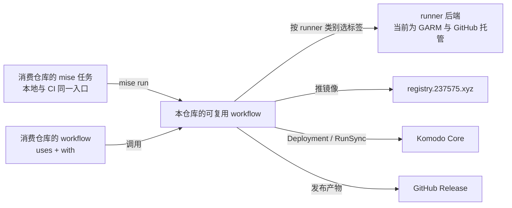

# CI 设计

## 问题

CI 难写有两个原因。

**一是基础设施约定在每个仓库里重写一遍，没有任何复用。** 2026-11-11 统计了本机 `mouriya-s-lab` 与 `moat-lab` 的自有仓库：

| 各仓库各自重复实现的内容 | workflow 文件数 |
|---|---|
| `runs-on` 写死 vctcn 的 GARM 标签 | 24 |
| 通过 Keycloak 换 token 并登录 `registry.237575.xyz`（这类文件合计 1337 行） | 9 |
| 用 job 级 `concurrency` 加 `queue: max` 串行化共享对象的写入 | 9 |
| SOPS 解密后写入 Komodo Variables，再执行 RunSync | 4 |
| 调用公共的可复用 workflow | 0 |

**二是仓库自己的构建、测试、发布逻辑写在 workflow YAML 里。** 这些逻辑只有推到 GitHub 才跑得起来，操作员和 coding agent 都没法在本地复现同一次检查。抽查的几个消费仓库里，只有 paseo 有 `mise.toml`；hapi、runner-canary、homelab-apps 没有任务入口，mattermost-plugin-openusage 用的是 `Makefile`。

后果：

- **新仓库接入成本高。** 接入前要先读懂 `local-cicd` skill 的全部规则，再照着写；漏掉任何一条，都要到运行时才会暴露。
- **基础设施一改，所有仓库都要跟着改。** runner 后端、registry 认证或 Komodo 触发方式一变，所有消费仓库都得逐个修改。所以 runner 方案的讨论被迫和 workflow 的写法绑在一起。
- **CI 失败没法在本地重现。** 修一个 CI 失败往往要反复推送提交，agent 也拿不到一条能在本地跑的检查命令。

## 目标

- **仓库逻辑写成 mise 任务。** 构建、测试、打包等仓库自己的逻辑，写成该仓库的 `mise` 任务（`check`、`build`、`release` 等）。本地执行 `mise run <task>`，和 CI 里跑的是同一条命令。
- **消费仓库的 CI 只调用可复用 workflow。** 消费仓库只提供自己的事实：要跑的任务、镜像名、构建上下文、Stack 名、SOPS 文件、产物名、需要的 runner 类别。
- **基础设施事实只在本仓库出现。** 包括 runner 标签、registry 地址与认证、Keycloak realm 与 client、Komodo 触发方式、并发规则。
- **runner 后端与消费仓库解耦。** 消费仓库只声明需要哪一类 runner；每一类对应哪组标签由本仓库决定。更换后端只改本仓库。

## 非目标

- 不重新设计 runner 后端。GARM 维持现状：每个仓库一个常驻 pool 加一个边缘 pool。后端设计另立文档，本仓库只通过 runner 类别给它留出落点（见「runner 类别」）。
- 不改 Komodo 一侧。workload repo 的 ResourceSync、Procedure 注册和 webhook 仍按 `km` skill 的现行约定，由各 workload repo 负责。
- 不涉及第三方仓库的 fork（codex、airi、oh-my-openagent 等），它们沿用上游的 CI。

## 结构

可复用 workflow 和 mise 任务的分工：

| 由 mise 任务承担 | 由可复用 workflow 承担 |
|---|---|
| 工具链版本、依赖安装、lint、测试、编译、打包，以及生成要发布的产物文件和 Docker 构建上下文 | checkout、安装 mise、选择 runner、registry 认证与推送、checksum 与 GitHub Release 发布、Komodo 触发、SOPS 解密与 Variables 写入、并发串行化 |

划分标准：只依赖仓库内容、在本地也能跑的，归 mise 任务；需要 secret、私有网络或修改共享状态的，归可复用 workflow。

本仓库是**公开**仓库，只放流程，不放 secret。公开的原因：

- 私有仓库里的可复用 workflow 只能被同一组织的仓库调用，而消费仓库分属 `mouriya-s-lab` 和 `moat-lab` 两个组织；
- 公开仓库可以被两个组织共用，不用维护两份。

## 可复用 workflow

按交付形态分四类，和 `local-cicd` skill 现有的分类一一对应：

| workflow | 交付形态 | 当前的消费仓库 |
|---|---|---|
| `check` | 运行消费仓库的 `mise run check` | 所有迁入的仓库 |
| `image` | 构建镜像 → 推送到 `registry.237575.xyz` → 触发 Komodo 部署 | `mouriya-s-lab/`：runner-canary、hapi、github-agent-router、netbird-xray-proxy、paseo、moat-browser-deploy，以及在 GitHub 托管 runner 上推送镜像的 github-automation |
| `workload-sync` | 把 workload repo 的 SOPS 解密后写入 Komodo Variables，再执行 RunSync | `mouriya-s-lab/`：homelab-apps、homelab-trading、vctcn-edge、runner-canary、moat-browser-deploy |
| `release-artifact` | 运行消费仓库的发布任务生成产物 → 计算 checksum → 发布到 GitHub Release | `mouriya-s-lab/`：mattermost-plugin-bookmarks、mattermost-plugin-openusage、hapi、moat-browser-deploy；`moat-lab/`：mattermost-plugin-codexbar、mattermost-plugin-fulcrum |

每个 workflow 的参数和 secret 以它自己文件里的 `workflow_call` 声明为准，由 actionlint 校验；本文档不重复列出字段。

只服务单个仓库的 E2E 和 canary（claude-code-pr-bridge-e2e、runner-canary 的探测类 workflow）留在各自仓库，不抽象成公共 workflow。它们的检查逻辑同样写成该仓库的 mise 任务。

## runner 类别

消费仓库按需求选择 runner 类别，不写标签：

| 类别 | 用途 |
|---|---|
| `private` | 需要访问 mesh 内服务的任务：Komodo、私有 registry 的 mesh 路径、homelab 服务 |
| `hosted` | 只需要公网的任务，跑在 GitHub 托管 runner 上 |
| `arm64` | 需要 arm64 架构的任务 |
| `large` | 内存超出常驻 runner 承受范围的任务 |

每个类别对应哪组标签、落在哪个后端，只在本仓库定义。后端重新设计以后，这张映射是唯一要改的地方。

`hosted` 不在 mesh 里，访问 `registry.237575.xyz` 走公网解析，`image` 的推送路径因此与 `private` 不同；这个差异由 `image` 内部处理，消费仓库不感知。

## 事实归属

| 事实 | 唯一来源 |
|---|---|
| runner 类别到标签的映射、registry 地址、Keycloak realm 与 client id、并发分组的命名规则 | 本仓库 |
| 要运行的 mise 任务及其实现、工具链版本 | 消费仓库的 `mise.toml` |
| 镜像名、构建上下文、Stack 名、SOPS 文件路径、产物名、runner 类别 | 消费仓库调用时传入的参数 |
| `KEYCLOAK_REGISTRY_CLIENT_SECRET` | `pve-vctcn/apps/registry` 的 secret 同步，写入每个消费仓库 |
| Komodo Procedure id 与 `webhook_secret` | workload repo，按 `km` skill 的约定 |
| workload repo 的 SOPS age key | workload repo 的 Actions secret |

并发分组的名字由本仓库根据传入的写入对象（Stack 名、镜像名、Release tag）拼出来。所有写同一个对象的调用都会落进同一个分组，消费仓库不自己声明并发。

消费仓库一律显式传入所需的 secret，不使用 `secrets: inherit`。原因：`inherit` 不能跨组织；两个组织统一用显式传入，写法就只有一种。

## 版本

- 消费仓库引用大版本 tag，例如 `@v1`。
- 本仓库的改动先在 runner-canary 的验证分支上验证：验证分支按 commit SHA 引用本仓库的待发布提交，跑通受影响的 workflow 之后，再移动大版本 tag。
- 需要消费仓库修改调用方式的改动，发布为新的大版本，旧版本 tag 保持不动。

## 迁移

按交付形态逐类迁移。每个消费仓库的迁移都走该仓库自己的 issue → PR，并分两步：

1. 把该仓库 workflow 里的构建、测试、打包逻辑移进 `mise.toml` 的任务，确认本地 `mise run <task>` 能通过；
2. 把 workflow 换成调用本仓库的可复用 workflow。

验收标准是可观测的交付结果与替换前一致：

- 镜像推到同样的仓库路径，打上同样的 tag；
- Komodo 部署的 Stack 换上新 digest，并且运行正常；
- Release 产物的文件名与 checksum 文件格式不变；
- RunSync 到达成功终态，Variables 的集合不变。

镜像 digest 每次构建都会变，不作为验收项。

各类的迁移顺序：

1. `image`：先迁 runner-canary 和 hapi，确认推镜像和部署两条路径都可用，再迁其余五个仓库。github-automation 用来验证 `hosted` 类别的推送路径。
2. `workload-sync`：先迁 runner-canary，再迁 homelab-apps、homelab-trading、vctcn-edge、moat-browser-deploy。
3. `release-artifact`：先迁四个 mattermost 插件，再迁 hapi 和 moat-browser-deploy 的 CLI release。
4. `check`：每个仓库在完成第 1 步（逻辑移进 mise 任务）后接入。

一类迁移完成后，`local-cicd` skill 里针对该类的 workflow 写法规则改为指向本仓库，不再保留两套写法。

## 未决

- **runner 后端重新设计：** 包括笔记本优先、VM 181 退回、Oracle ARM 只接 `arm64` 类别、镜像缓存跨任务保留、按机器而不是按仓库限制并发，另立设计文档。设计定下来以后，只改本仓库里 runner 类别的映射。
