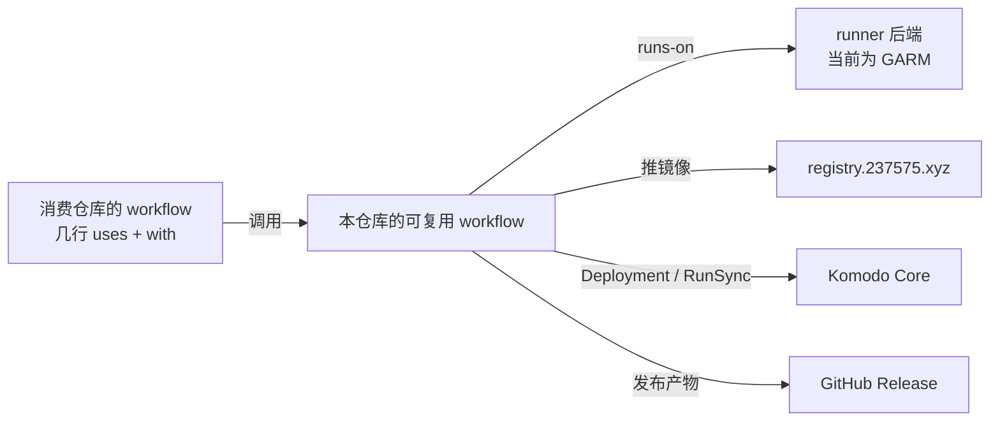

# CI 设计

## 问题

CI 难写，不是因为 runner 技术选得不对，而是每个仓库的 workflow 都要自己实现一遍整套基础设施约定，而且没有任何复用。2026-11-11 对本机 `mouriya-s-lab` 与 `moat-lab` 自有仓库的统计：

| 各仓库各自重复实现的内容 | workflow 文件数 |
|---|---|
| `runs-on` 写死 vctcn 的 GARM 标签 | 24 |
| 通过 Keycloak 换 token 并登录 `registry.237575.xyz`（这类文件合计 1337 行） | 9 |
| 用 job 级 `concurrency` 加 `queue: max` 串行化共享对象的写入 | 9 |
| SOPS 解密后写入 Komodo Variables，再执行 RunSync | 4 |
| 调用公共的可复用 workflow | 0 |

因此有两个后果：

- **新仓库接入成本高。** 接入 CI 要先读懂 `local-cicd` skill 的全部规则，再照着写；漏掉任何一条，到运行时才会暴露。
- **基础设施一改就要改所有仓库。** runner 后端、registry 认证方式或 Komodo 触发方式一变，所有消费仓库都要逐个修改。runner 方案的讨论（GARM、k3s、Oracle ARM、笔记本优先）因此被迫和 workflow 的写法绑在一起。

## 目标

- 消费仓库的 CI 只是调用本仓库的可复用 workflow，只填写仓库自己的事实：镜像名、构建上下文、Stack 名、SOPS 文件、产物名。
- 基础设施事实只在本仓库出现：runner 标签、registry 地址与认证、Keycloak realm 与 client、Komodo 触发方式、并发规则。
- runner 后端的选择与消费仓库解耦。换后端只改本仓库，消费仓库一行不动。

## 非目标

- 不重做 runner 后端。GARM 维持现状（每个仓库一个常驻 pool 加一个边缘 pool）；后端重设计另立文档。
- 不改 Komodo 一侧：workload repo 的 ResourceSync、Procedure 注册和 webhook 仍按 `km` skill 的现行约定，由各 workload repo 负责。
- 不涉及第三方仓库的 fork（codex、airi、oh-my-openagent 等），它们沿用上游的 CI。

## 结构

本仓库是**公开**仓库，只放流程，不放 secret。公开的原因：

- 私有仓库里的可复用 workflow 只能被同一组织的仓库调用，而消费仓库分属 `mouriya-s-lab` 和 `moat-lab` 两个组织；
- 公开仓库可以被两个组织共用，不用维护两份。

## 可复用 workflow

按交付形态分四类，和 `local-cicd` skill 现有的分类一一对应：

| workflow | 交付形态 | 当前的消费仓库 |
|---|---|---|
| `image` | 构建镜像 → 推送到 `registry.237575.xyz` → 触发 Komodo 部署 | `mouriya-s-lab/`：runner-canary、hapi、github-agent-router、netbird-xray-proxy、paseo、moat-browser-deploy，以及在 GitHub 托管 runner 上推送镜像的 github-automation |
| `workload-sync` | 把 workload repo 的 SOPS 解密后写入 Komodo Variables，再执行 RunSync | `mouriya-s-lab/`：homelab-apps、homelab-trading、vctcn-edge、runner-canary、moat-browser-deploy |
| `release-artifact` | 构建发布产物 → 计算 checksum → 发布到 GitHub Release | `mouriya-s-lab/`：mattermost-plugin-bookmarks、mattermost-plugin-openusage、hapi、moat-browser-deploy；`moat-lab/`：mattermost-plugin-codexbar、mattermost-plugin-fulcrum |
| `check` | lint 与测试 | 有第一个消费仓库时再定义 |

只服务单个仓库的 E2E 和 canary（claude-code-pr-bridge-e2e、runner-canary 的探测类 workflow）留在各自仓库，不抽象成公共 workflow。

## 事实归属

| 事实 | 唯一来源 |
|---|---|
| runner 标签、registry 地址、Keycloak realm 与 client id、并发分组的命名 | 本仓库 |
| 镜像名、构建上下文、Stack 名、SOPS 文件路径、产物名 | 消费仓库调用时的 `with` |
| `KEYCLOAK_REGISTRY_CLIENT_SECRET` | `pve-vctcn/apps/registry` 的 secret 同步，写入每个消费仓库 |
| Komodo Procedure id 与 `webhook_secret` | workload repo，按 `km` skill 的约定 |
| workload repo 的 SOPS age key | workload repo 的 Actions secret |

消费仓库一律显式传入所需的 secret，不使用 `secrets: inherit`。原因：`inherit` 不能跨组织；两个组织统一用显式传入，写法就只有一种。

## 版本

- 消费仓库引用大版本 tag，例如 `@v1`。
- 本仓库的改动先在 runner-canary 上验证通过，再移动大版本 tag。
- 需要消费仓库修改调用方式的改动，发布为新的大版本，旧版本 tag 保持不动。

## 迁移

按交付形态逐类迁移。每个消费仓库的迁移都走该仓库自己的 issue → PR。迁移的验收标准是：替换后产出的镜像、产物和部署结果，与替换前相同。

1. `image`：先迁 runner-canary 和 hapi，确认推镜像和部署两条路径都可用，再迁其余五个仓库。
2. `workload-sync`：先迁 runner-canary，再迁 homelab-apps、homelab-trading、vctcn-edge、moat-browser-deploy。
3. `release-artifact`：先迁四个 mattermost 插件，再迁 hapi 和 moat-browser-deploy 的 CLI release。

一类迁移完成后，`local-cicd` skill 里针对该类的 workflow 写法规则改为指向本仓库，不再保留两套写法。

## 未决

- **runner 后端重设计：** 笔记本优先、VM 181 退回、Oracle ARM 只接点名任务、镜像缓存、按机器而不是按仓库限制并发，另立设计文档。本仓库只提供一个落点：后端定下来以后，只改本仓库里的 runner 标签。
- **`check` 的内容：** 由第一个消费仓库的需求来定。
